<div align="center">


# AG News Text Classification

[](LICENSE)
[](https://www.python.org/)
[](https://github.com/astral-sh/ruff)
[](https://mypy-lang.org/)
[](https://docs.pytest.org/)

[](https://pytorch.org/)
[](https://huggingface.co/docs/transformers)
[](https://huggingface.co/docs/datasets)
[](https://huggingface.co/docs/accelerate)
[](https://scikit-learn.org/)

[](https://github.com/huggingface/setfit)
[](https://fasttext.cc/)
[](https://cleanlab.ai/)
[](https://maartengr.github.io/BERTopic/)
[](https://shap.readthedocs.io/)
[](https://github.com/marcotcr/lime)

[](https://onnx.ai/)
[](https://onnxruntime.ai/)
[](https://huggingface.co/docs/optimum)
[](https://www.gradio.app/)

[](https://wandb.ai/)
[](https://mlflow.org/)
[](https://optuna.org/)
[](src/deployment/gradio_app.py)

</div>

End-to-end NLP pipeline for the AG News topic classification benchmark, developed as
the Samsung Innovation Campus (SIC) AI Course capstone project. The project re-examines
a classic four-class news topic dataset using the modern NLP toolkit: state-of-the-art
transformers, R-Drop variance-reduction ablation, multi-seed soft-voting ensembling,
post-hoc confidence calibration, few-shot learning, label-noise auditing,
explainability, multilingual extension to Vietnamese and French, and a multi-model
local Gradio demo with automatic three-way language routing.

## 1. Headline results

| Objective | Metric | Target | Achieved | Status |
|-----------|--------|--------|---------:|:------:|
| O1 | F1-macro on AG News test set (best English model) | ≥ 0.95 | **0.9528** (R-Drop 3-seed soft-voting ensemble of ModernBERT-large) | met |
| O2 | F1-macro of SetFit at 64 samples per class | ≥ 0.93 | 0.8755 (mean of 3 seeds) | not met |
| O3 | F1-macro on Vietnamese AG News (best multilingual model) | ≥ 0.90 | **0.9041** (XLM-R-large + back-translation) | met |
| O4 | Expected Calibration Error of the best model | ≤ 0.03 | **0.0285** (temperature scaling → isotonic regression, chained) | met |
| O5 | ONNX INT8 inference latency (CPU, batch size 1) | ≤ 50 ms / sample | 290 ms (best of 12 models) | not met, hardware-bounded |
| O6 | Public GitHub repository accessible end-to-end | URL responds 200 OK | [VoHaiDung/ag-news-text-classification](https://github.com/VoHaiDung/ag-news-text-classification) | met |
| O7 | Final report submitted using the SIC template | One ``.docx`` file | One file under ``reports/`` | met |
| O8 | F1-macro on French AG News (best multilingual model) | ≥ 0.90 | **0.9466** (XLM-R-large) | met |

Six of eight numbered objectives are met. The two unmet objectives are documented
honestly in the final report rather than hidden: O2 (SetFit ceiling on balanced
four-class corpora, Section 3.3.4) and O5 (batch-1 transformer inference is
sequential-bound on commodity x86 CPUs, Section 3.5.3).

## Demo video

A ~36-second product walkthrough of the multi-model Gradio app — English,
Vietnamese and French classification, automatic model routing, the
sliding-window long-document path, the full softmax breakdown and the SHAP
explanation — is available at
[`SIC_AI_Capstone_Project_Demo_Video.mp4`](SIC_AI_Capstone_Project_Demo_Video.mp4).
The shot-by-shot script and the static frames behind it live under
[`reports/presentation/`](reports/presentation/)
(`demo_video_script.md`, `demo_inputs.txt`, `demo_frames/`).

## Demo screenshots

Every screenshot below was captured from the running app (`uv run run_demo.py`,
dark theme). Each panel shows the checkpoint picked by the language router, the
input, the predicted class, the full softmax over the four classes and the
inference mode.

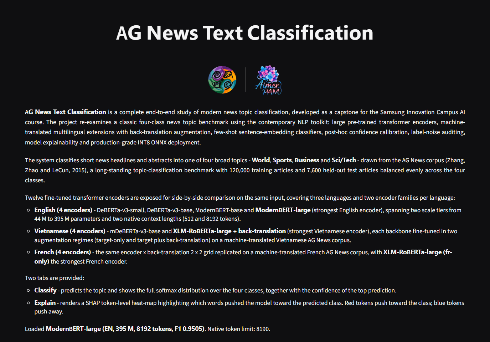

### Classify: English (routed to ModernBERT-large)

| World | Sports |
| :---: | :----: |
| 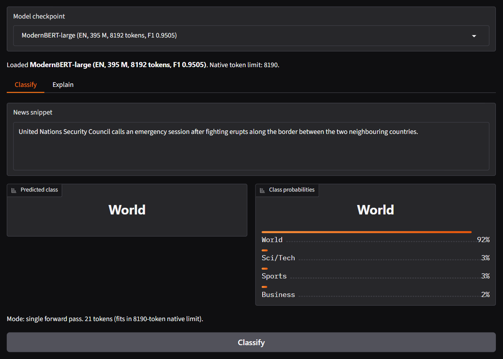 | 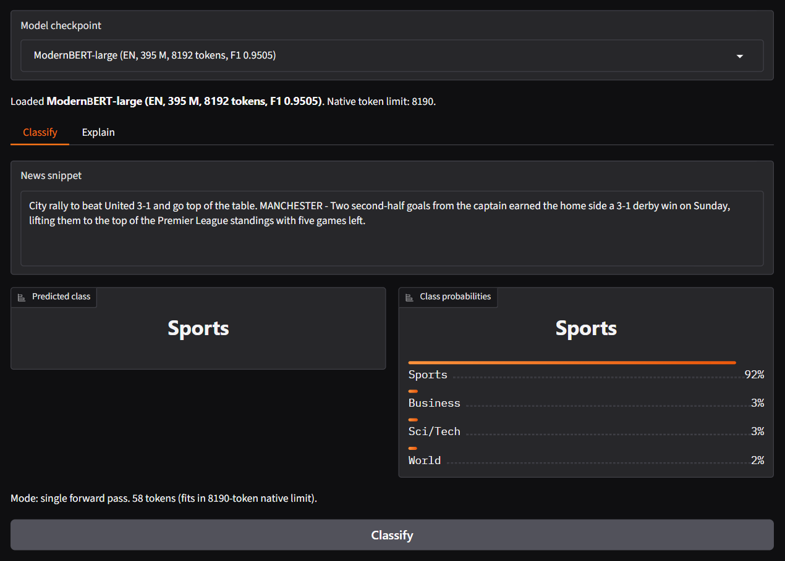 |
| **Business** | **Sci/Tech** |
|  |  |

### Classify: Vietnamese (routed to XLM-R-large vi+BT)

| World | Sports |
| :---: | :----: |
| 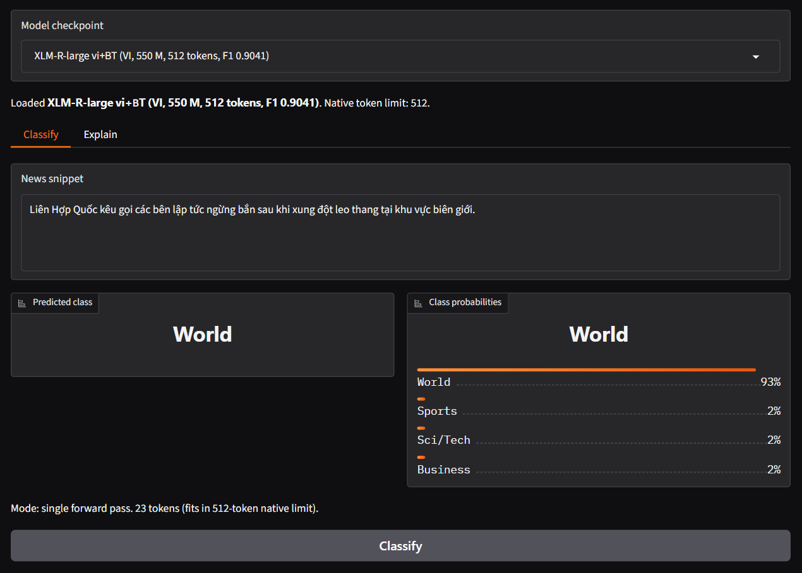 | 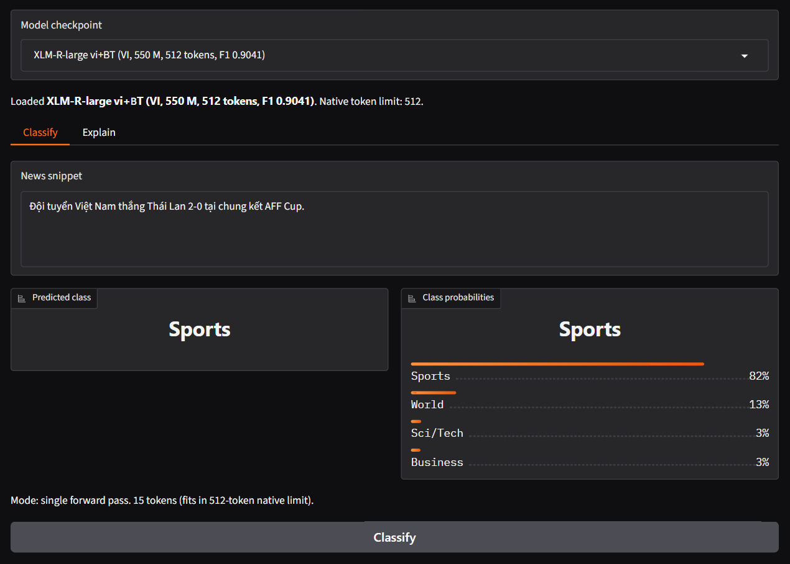 |
| **Business** | **Sci/Tech** |
|  | 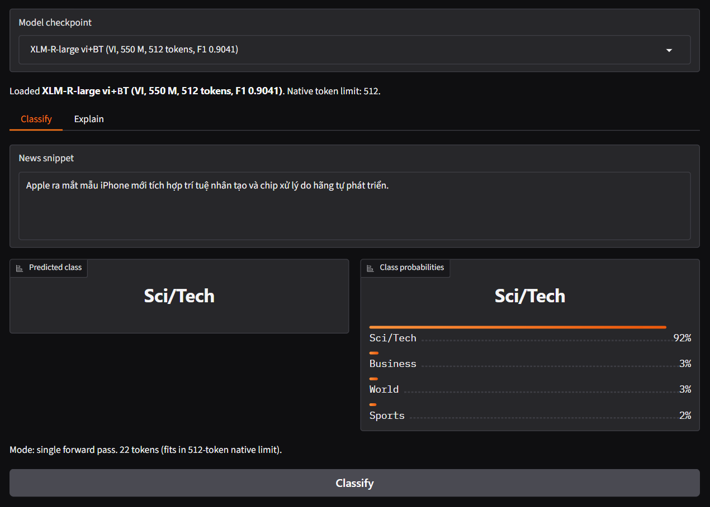 |

### Classify: French (routed to XLM-R-large fr-only)

| World | Sports |
| :---: | :----: |
| 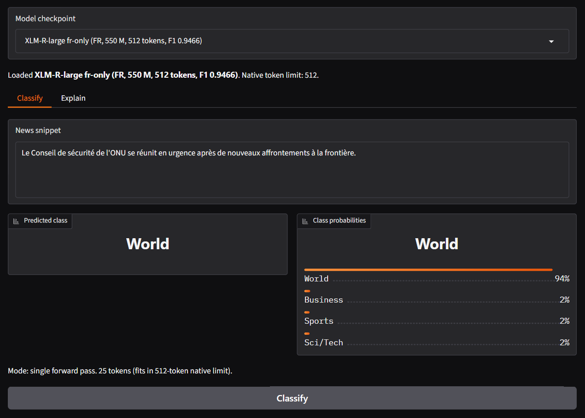 | 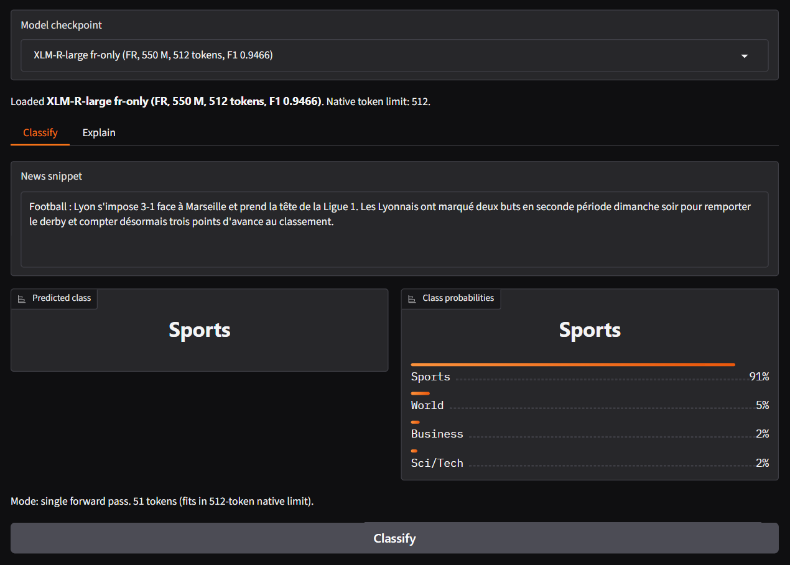 |
| **Business** | **Sci/Tech** |
| 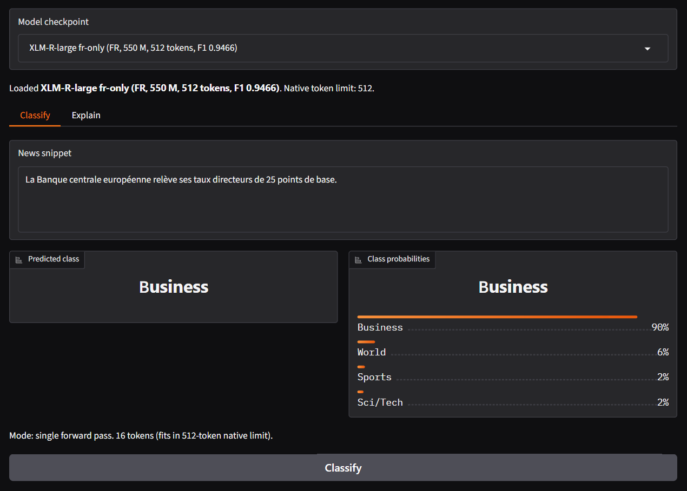 | 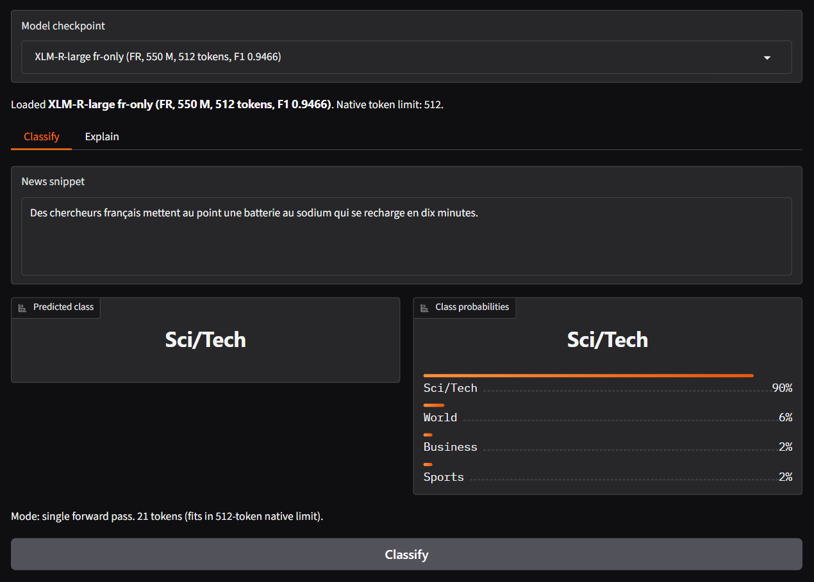 |

### Long document: sliding window

A 649-token NASA article (public domain, from
[`demo_inputs.txt`](reports/presentation/demo_inputs.txt)) classified with
DeBERTa-v3-base, selected by hand in the picker. The input exceeds the
510-token native limit, so it is split into two 510-token windows with stride
255 and the window softmaxes are mean-pooled.

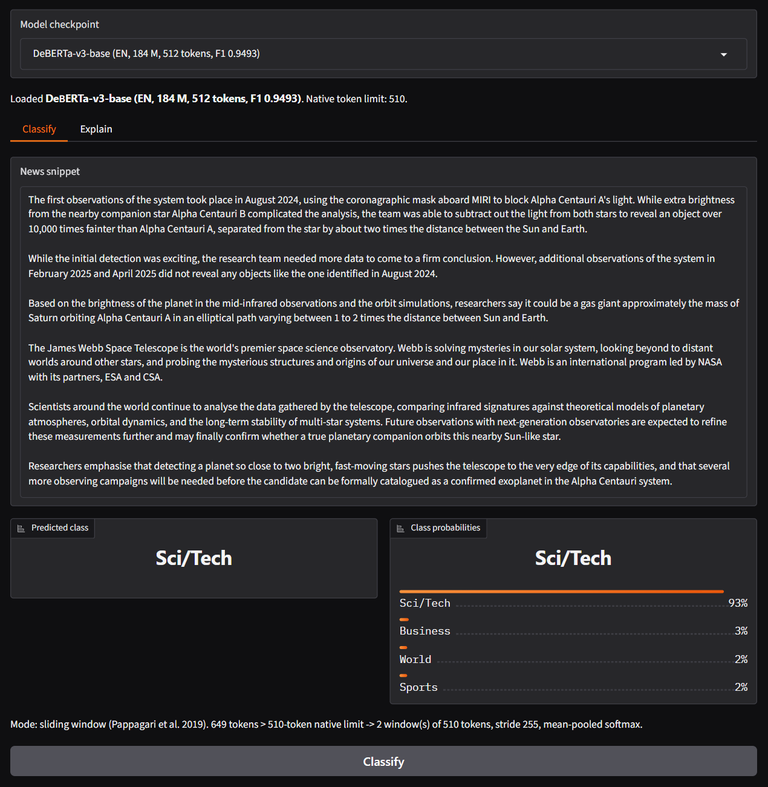

### Explain: SHAP token attributions

Red tokens push the model toward the predicted class, blue tokens push away.

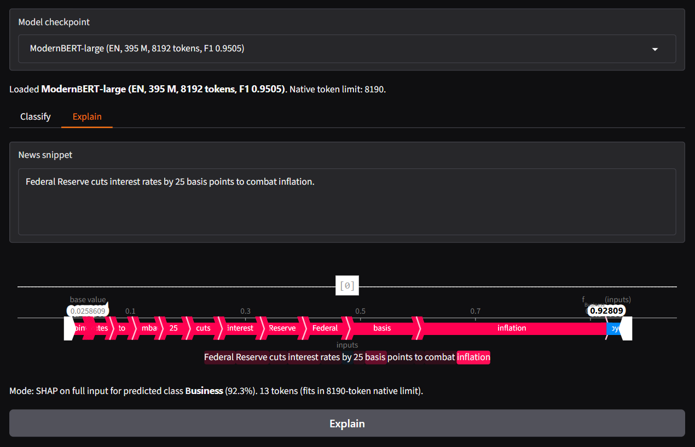

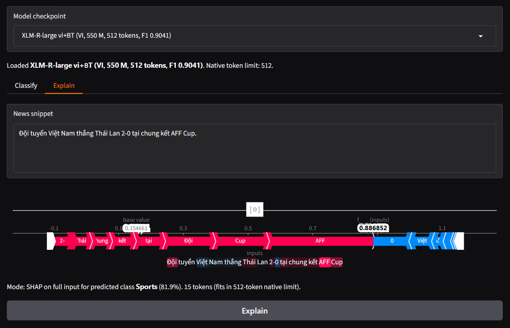

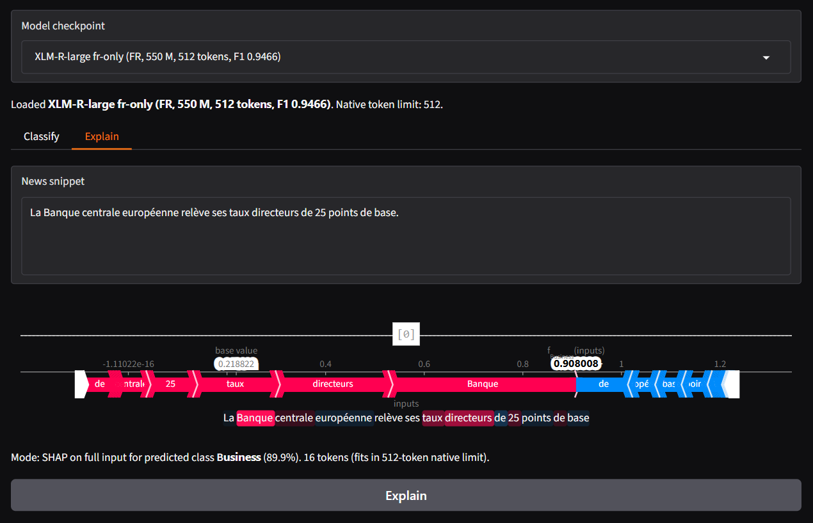

### All test cases

| # | Language | Input | Checkpoint | Expected | Predicted |
| -: | -------- | ----- | ---------- | -------- | --------- |
| 1 | English | United Nations Security Council calls an emergency session after fighting erupts along the border between the two neighbouring countries. | ModernBERT-large | World | World (92%) |
| 2 | English | City rally to beat United 3-1 and go top of the table. MANCHESTER - Two second-half goals from the captain earned the home side a 3-1 derby win on Sunday, lifting them to the top of the Premier League standings with five games left. | ModernBERT-large | Sports | Sports (92%) |
| 3 | English | Oil prices jump 4% after OPEC+ agrees to extend production cuts into next year. | ModernBERT-large | Business | Business (90%) |
| 4 | English | NASA Perseverance rover discovers ancient microbial life on Mars surface. | ModernBERT-large | Sci/Tech | Sci/Tech (90%) |
| 5 | English | NASA Webb article on a planet candidate around Alpha Centauri A (649 tokens) | DeBERTa-v3-base | Sci/Tech | Sci/Tech (93%), 2 windows |
| 6 | English | Federal Reserve cuts interest rates by 25 basis points to combat inflation. *(Explain)* | ModernBERT-large | Business | Business (92.3%) |
| 7 | Vietnamese | Liên Hợp Quốc kêu gọi các bên lập tức ngừng bắn sau khi xung đột leo thang tại khu vực biên giới. | XLM-R-large vi+BT | World | World (93%) |
| 8 | Vietnamese | Đội tuyển Việt Nam thắng Thái Lan 2-0 tại chung kết AFF Cup. | XLM-R-large vi+BT | Sports | Sports (82%) |
| 9 | Vietnamese | Ngân hàng Nhà nước giảm lãi suất điều hành 0,5 điểm phần trăm nhằm hỗ trợ doanh nghiệp phục hồi sản xuất. | XLM-R-large vi+BT | Business | Business (92%) |
| 10 | Vietnamese | Apple ra mắt mẫu iPhone mới tích hợp trí tuệ nhân tạo và chip xử lý do hãng tự phát triển. | XLM-R-large vi+BT | Sci/Tech | Sci/Tech (92%) |
| 11 | Vietnamese | Đội tuyển Việt Nam thắng Thái Lan 2-0 tại chung kết AFF Cup. *(Explain)* | XLM-R-large vi+BT | Sports | Sports (81.9%) |
| 12 | French | Le Conseil de sécurité de l'ONU se réunit en urgence après de nouveaux affrontements à la frontière. | XLM-R-large fr-only | World | World (94%) |
| 13 | French | Football : Lyon s'impose 3-1 face à Marseille et prend la tête de la Ligue 1. Les Lyonnais ont marqué deux buts en seconde période dimanche soir pour remporter le derby et compter désormais trois points d'avance au classement. | XLM-R-large fr-only | Sports | Sports (91%) |
| 14 | French | La Banque centrale européenne relève ses taux directeurs de 25 points de base. | XLM-R-large fr-only | Business | Business (90%) |
| 15 | French | Des chercheurs français mettent au point une batterie au sodium qui se recharge en dix minutes. | XLM-R-large fr-only | Sci/Tech | Sci/Tech (90%) |
| 16 | French | La Banque centrale européenne relève ses taux directeurs de 25 points de base. *(Explain)* | XLM-R-large fr-only | Business | Business (89.9%) |
| 17 | English | Lionel Messi scores twice as Inter Miami beat Orlando City 3-1 to reach the MLS Cup final. | ModernBERT-large | Sports | **World (92%)** |
| 18 | English | Roger Federer beats Andy Roddick in straight sets to win his third straight Wimbledon title. | ModernBERT-large | Sports | **World (92%)** |
| 19 | French | Le PSG remporte la Ligue des champions en battant l'Inter Milan 2-0 en finale. | XLM-R-large fr-only | Sports | **World (87%)** |
| 20 | French | Tennis : l'Espagnol remporte la finale de Roland-Garros en trois sets et soulève la Coupe des Mousquetaires. | XLM-R-large fr-only | Sports | **World (94%)** |

Sixteen of the twenty cases are classified correctly. The four misses (rows
17 to 20) share one pattern, shown below.

### Known limitation: short sports headlines

AG News items pair a headline with a one-sentence description. A short sports
headline built around player and club names, with no description, drifts to
World on the English and French checkpoints, while the same kind of match
written in AG News style (rows 2 and 13) is classified as Sports. On the AG
News test set itself, Sports is the most accurate class (1,881 of 1,900 correct
for ModernBERT-large), which points to the input format rather than the class
as the cause of these misses.

| English | French |
| :-----: | :----: |
| 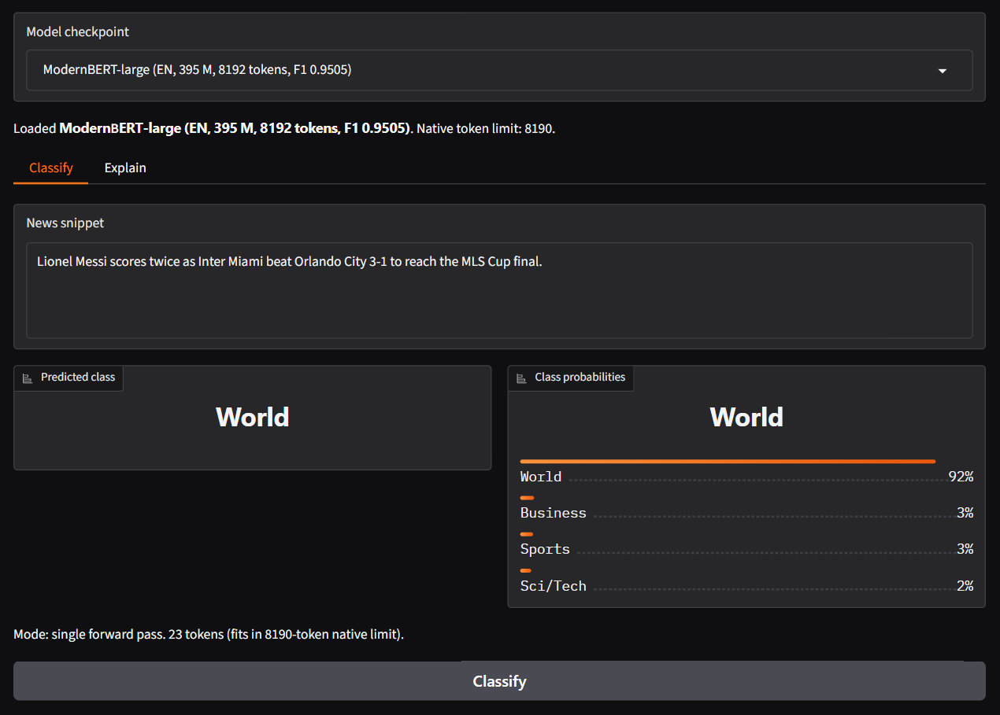 | 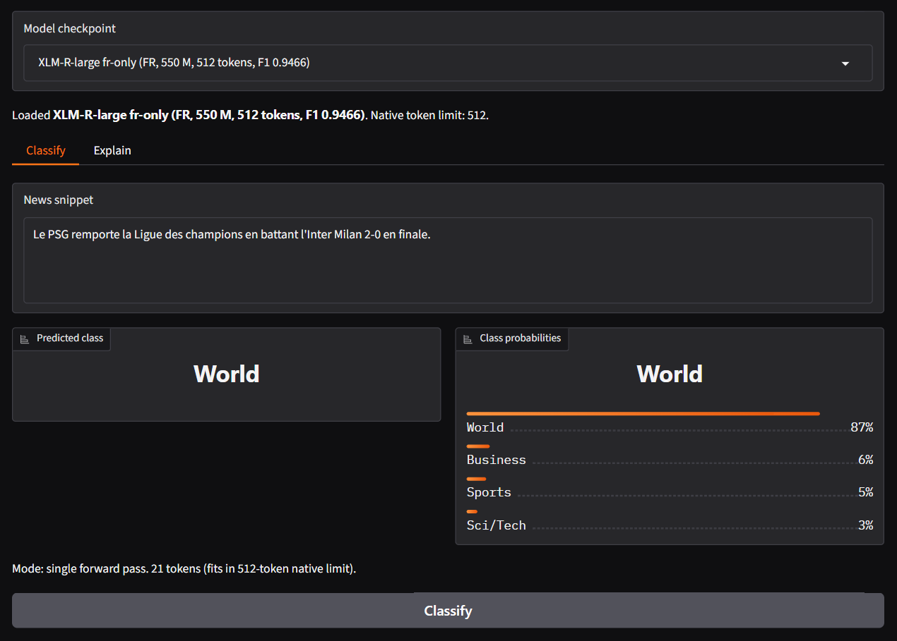 |
| 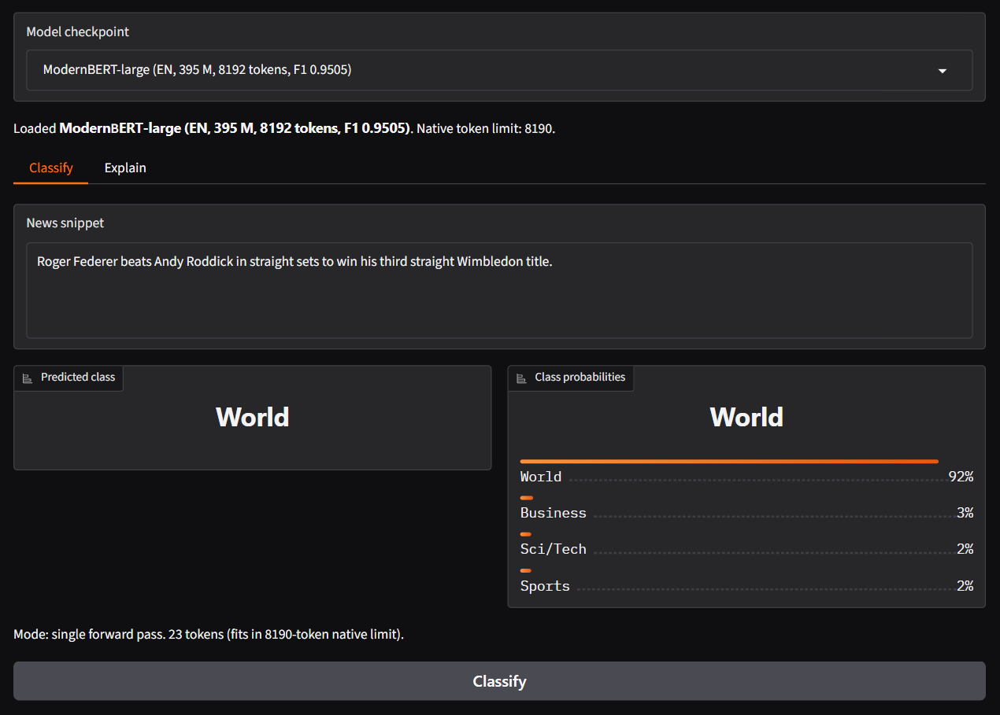 | 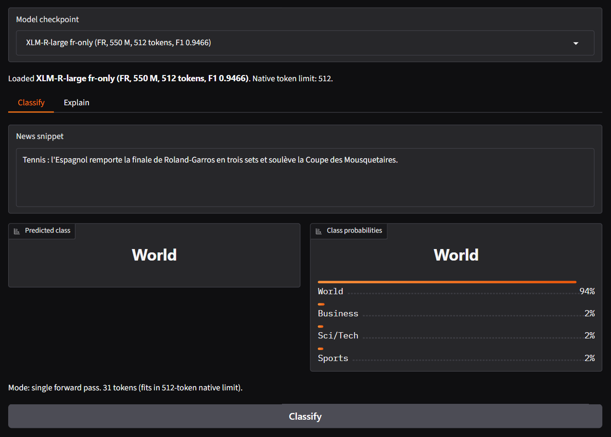 |

## 2. The twelve-model lineup

Twelve supervised transformer checkpoints span four English encoders, four
Vietnamese encoders and four French encoders (the multilingual languages each
form a 2 x 2 grid of encoder x back-translation augmentation). Three classical
baselines and a SetFit learning curve sit alongside the transformer matrix.

| Language | Encoder family | Variants | Best test F1-macro |
|----------|----------------|----------|-------------------:|
| English | DeBERTa-v3 / ModernBERT | small (44 M) / base (149 M) / base (184 M) / large (395 M) | 0.9528 (R-Drop 3-seed ensemble) |
| Vietnamese | mDeBERTa-v3 / XLM-R-large | encoder x back-translation 2 x 2 | 0.9041 (XLM-R-large + BT) |
| French | mDeBERTa-v3 / XLM-R-large | encoder x back-translation 2 x 2 | 0.9466 (XLM-R-large) |

All twelve transformers are exported to dynamic INT8 ONNX (Optimum, opset 17)
and benchmarked end-to-end on the same single-stream CPU host to produce the
latency-accuracy Pareto front used to identify the deployment-tier model
(ModernBERT-base INT8, 147 MB, 289.83 ms per sample, F1 = 0.9471).

## 3. Project structure

```text
ag-news-text-classification/
├── assets/                  Brand assets rendered by the Gradio UI, README screenshots
│   ├── screenshots/                             Demo UI captures used in the README
│   ├── logo-ag-news-text-classification.png    Project logo (centered above the title)
│   ├── logo-aimer-pam.png                       Team logo (top-right attribution badge)
│   └── NOTICE-AIMER-PAM.md                      Rights notice for the team name and logo (not MIT)
├── configs/                 YAML configuration files (data, model, training, sweeps)
├── data/                    Datasets (git-ignored, managed by HuggingFace Hub)
├── notebooks/               Jupyter notebooks for exploration
├── outputs/                 Trained checkpoints, metrics, figures, INT8 models (git-ignored)
├── reports/                 Final report (Markdown + SIC docx), slides, demo video script
├── scripts/                 Phase-level entry points mapping 1:1 to the WBS
├── src/                     Reusable library code
│   ├── configs/             Dataclass-based configuration schema
│   ├── data/                Loaders, EDA, augmentation, translation
│   ├── deployment/          ONNX export, quantization, multi-model Gradio app
│   ├── evaluation/          Metrics, calibration, latency, error analysis
│   ├── explainability/      SHAP and LIME explainers
│   ├── inference/           Long-document classifier (sliding-window aggregation)
│   ├── models/              Baselines and transformer wrappers
│   ├── training/            Trainers (including the R-Drop subclass), sweep utilities
│   └── utils/               Logging, reproducibility, IO, tracking
├── tests/                   Pytest unit tests
├── bootstrap.cmd            One-step launcher for Windows (installs uv if absent)
├── bootstrap.sh             One-step launcher for macOS and Linux
├── run_demo.py              Self-contained demo launcher (PEP 723, no setup required)
├── pyproject.toml           Build system + tool configuration
├── requirements.txt         Pinned runtime dependencies
└── README.md                This file
```

## 4. Phase to script mapping

The [Work Breakdown Structure](SIC_AI_Capstone_Project_Work_Breakdown_Structure.xlsx)
defines nine sequential phases. Each phase has a corresponding entry point in
``scripts/``; the post-hoc ablation, calibration, ensembling and latency studies
that produced the headline numbers above are factored into dedicated helper
scripts that are invoked from Phase 7 and Phase 8.

| Phase | Title                                          | Primary script                    |
|-------|------------------------------------------------|-----------------------------------|
| 1     | Project Kickoff and Research                   | ``scripts/phase1_kickoff.py``     |
| 2     | Exploratory Data Analysis                      | ``scripts/phase2_eda.py``         |
| 3     | Baseline Models                                | ``scripts/phase3_baselines.py``   |
| 4     | Transformer Fine-tuning                        | ``scripts/phase4_transformers.py``|
| 5     | Multilingual Extension (Vietnamese and French) | ``scripts/phase5_multilingual.py``|
| 6     | Few-shot Learning with SetFit                  | ``scripts/phase6_setfit.py``      |
| 7     | Evaluation and Explainability                  | ``scripts/phase7_evaluation.py``  |
| 8     | Demo and Deployment                            | ``scripts/phase8_deployment.py``  |
| 9     | Report and Presentation                        | ``scripts/phase9_report.py``      |

### Post-hoc helper scripts

| Script | Purpose | Cited in |
|--------|---------|----------|
| ``scripts/ensemble_inference.py`` | Soft-voting ensemble across N HuggingFace checkpoints; produces the R-Drop 3-seed ensemble that meets O1. | Section 3.3.2.5 |
| ``scripts/calibrate_model.py`` | Four-calibrator ECE grid (baseline / temperature scaling / isotonic regression / temperature → isotonic chained); produces the calibrator that meets O4. | Section 3.5.2 |
| ``scripts/export_all_int8.py`` | Batch ONNX FP32 export + dynamic INT8 quantization of the entire twelve-model lineup. | Section 3.5.3 |
| ``scripts/benchmark_all_latency.py`` | Single-stream and multi-thread CPU latency benchmark across the twelve INT8 models; produces the Pareto-front table cited in Section 3.5.3. | Section 3.5.3 |
| ``scripts/local_inference.py`` | Offline CPU inference helper for any downloaded checkpoint (regular PyTorch path or ONNX INT8 path); useful for reviewers without a GPU. | - |
| ``scripts/sync_from_remote.py`` | Filtered tar-over-SSH sync that pulls metric files / figures / INT8 artefacts from a rented cloud GPU host to the local machine. | - |

## 5. Quick start

```bash
# 1. Clone and create a virtual environment
python -m venv .venv
source .venv/bin/activate     # Linux / macOS
.venv\Scripts\activate        # Windows PowerShell

# 2. Install dependencies
pip install -e ".[dev]"

# 3. Configure secrets (optional, only needed if WANDB / HF tracking is enabled)
cp .env.example .env
# edit .env to add WANDB_API_KEY and HF_TOKEN

# 4. Run a phase end-to-end (example: Phase 2 EDA)
python -m scripts.phase2_eda --config configs/data/ag_news.yaml
```

### Launch the multi-model Gradio demo

On a machine carrying no developer tooling at all — no Python, no package
manager, no compiler — a single file does everything. It fetches
[uv](https://docs.astral.sh/uv/) when missing, puts it on the path of that one
process and starts the demo:

```bat
bootstrap.cmd
```

```bash
sh bootstrap.sh
```

The first is for Windows and can be double-clicked or run from any shell; the
second covers macOS and Linux. Nothing is installed system-wide, no
Administrator or ``sudo`` prompt appears, and the terminal does not have to be
restarted afterwards.

The Windows entry point is a ``.cmd`` rather than a ``.ps1`` deliberately:
batch files are exempt from the PowerShell execution policy that blocks
unsigned scripts arriving inside a downloaded ZIP, and the uv installer is
invoked through a child PowerShell carrying ``-ExecutionPolicy Bypass``, so no
machine-wide policy is ever changed. Flags are forwarded, so
``bootstrap.cmd --share`` and ``sh bootstrap.sh --lan`` behave as documented
below.

Where uv is already installed and on the path, the launcher can be called
directly instead:

```bash
uv run run_demo.py
```

To install uv by hand, use the invocation published by Astral — the
``-ExecutionPolicy Bypass`` on the Windows line is required, without it the
installer refuses to run:

```bash
powershell -ExecutionPolicy Bypass -c "irm https://astral.sh/uv/install.ps1 | iex"   # Windows
curl -LsSf https://astral.sh/uv/install.sh | sh                                     # macOS / Linux
```

``run_demo.py`` pins CPython 3.12 through PEP 723 inline metadata and installs
only the fifteen wheels the demo actually imports (``matplotlib`` among them,
which recent ``shap`` releases need to render the Explain tab). It therefore leaves the
interpreter already present on the host untouched, and skips the four
compile-only training dependencies (``fasttext``, ``hdbscan``, ``umap-learn``,
``bertopic``) that would otherwise require a C++ toolchain.

Where the environment is already provisioned through ``pip install -e .``, the
app module can still be started directly:

```bash
python -m src.deployment.gradio_app
```

The demo classifies with a sliding-window path for inputs that exceed the
512-token native context of DeBERTa-style models, and routes automatically
between the English, Vietnamese and French checkpoints.

#### Seeing all twelve checkpoints

A single app hosts all twelve checkpoints, swapped in place by the ``Model
checkpoint`` dropdown, so there is one UI to launch rather than one per model.
The dropdown is deliberately progressive: it stays hidden while the textbox is
empty, and once text is entered it offers the four checkpoints of the detected
language, which keeps the choice relevant to what is actually being classified.

To enumerate the full lineup without opening the UI, ask the launcher:

```bash
uv run run_demo.py --list-models
```

To reach all three language branches in the UI, paste one snippet per
language — the picker re-populates on every keystroke:

| Language | Snippet | Picker switches to |
| -------- | ------- | ------------------ |
| English | ``NASA Perseverance rover discovers ancient microbial life on Mars surface.`` | ModernBERT-large (EN) |
| Vietnamese | ``Đội tuyển Việt Nam thắng Thái Lan 2-0 tại chung kết AFF Cup.`` | XLM-R-large vi+BT (VI) |
| French | ``La Banque centrale européenne relève ses taux directeurs de 25 points de base.`` | XLM-R-large fr-only (FR) |

These three lines, with their expected predictions, come from
[`reports/presentation/demo_inputs.txt`](reports/presentation/demo_inputs.txt),
which also holds the long-document and SHAP samples used in the demo video.

#### Launcher options

| Command | Effect |
| ------- | ------ |
| ``uv run run_demo.py --list-models`` | List the checkpoints present under ``outputs/`` |
| ``uv run run_demo.py --lan`` | Serve on the local network for a same-room demo |
| ``uv run run_demo.py --share`` | Public ``*.gradio.live`` link, valid for 72 hours |
| ``uv run run_demo.py --model-dir <path>`` | Preload one specific checkpoint |
| ``uv run run_demo.py --port 8000`` | Serve on a port other than 7860 |

#### Troubleshooting a machine that has never run code

Every symptom below comes from operating-system defaults rather than from the
project. ``bootstrap.cmd`` avoids the three PowerShell and ``PATH`` symptoms;
the manual remedies are listed for anyone who prefers to install uv by hand.

| Symptom | Cause | Manual remedy |
| ------- | ----- | ------------- |
| ``Error: PowerShell requires an execution policy in [Unrestricted, RemoteSigned, Bypass] to run uv`` | The execution policy is ``Restricted`` or ``Undefined``, so the downloaded installer is refused. | Add ``-ExecutionPolicy Bypass`` to the install line, as shown above. |
| ``UnauthorizedAccessException ... Access to the registry key 'HKEY_LOCAL_MACHINE\SOFTWARE\Microsoft\PowerShell\1\ShellIds\Microsoft.PowerShell' is denied`` | ``Set-ExecutionPolicy RemoteSigned`` without a scope writes the machine-wide key and needs an Administrator terminal. | Nothing machine-wide is required; if a policy change is still wanted, scope it with ``Set-ExecutionPolicy RemoteSigned -Scope CurrentUser``. |
| ``uv : The term 'uv' is not recognized as the name of a cmdlet ...`` | The installer extended the user ``PATH``, but the running terminal inherited its environment before that. In VS Code the terminal inherits from the VS Code process, so opening a new terminal tab is not enough. | Quit VS Code completely and reopen it, or extend the path for the current session with ``$env:Path = "$env:USERPROFILE\.local\bin;$env:Path"``. |
| ``error: Failed to spawn: python`` or ``ImportError: DLL load failed``, both ending in ``An Application Control policy has blocked this file`` | Windows 11 Smart App Control is on and blocks the unsigned interpreter launcher and native extension DLLs (``pyarrow``, ``torch``) of the environment uv builds. | Turn it off under Windows Security > App & browser control > Smart App Control settings, then run the launcher again. On many Windows 11 builds it cannot be switched back on without resetting Windows; where it must stay on, run the demo on another machine and connect with ``--lan`` or ``--share``. |
| ``bootstrap.sh: bad interpreter`` or ``^M`` at line ends on macOS/Linux | The file was checked out with Windows line endings. | [`.gitattributes`](.gitattributes) pins ``*.sh`` to LF; re-clone, or run ``git add --renormalize .``. |
| ``sh bootstrap.sh`` reports neither curl nor wget | Minimal container images ship with neither. | Install one, or follow the manual uv installation above. |

Checkpoints live under ``outputs/``, which ``.gitignore`` excludes from version
control: they travel with a copy of the project folder but never with a ``git
clone`` or a downloaded ZIP. The launcher reports a missing ``outputs/`` tree
up-front instead of failing inside the model loader, and falls back to any
checkpoint that is present when the default one is absent.

Both ``--lan`` and ``--share`` keep the weights on the host machine and need
nothing installed on the viewer's side, which makes them the route to a demo
that does not involve publishing the checkpoints anywhere.

## 6. Reproducibility

All random seeds are controlled centrally by ``src.utils.repro.set_global_seed``.
Configurations are versioned through YAML files under ``configs/``. Experiment
artefacts (metrics, model checkpoints, plots) are logged to Weights and Biases
and mirrored locally under ``outputs/``. The R-Drop ablation grid is fully
declarative: each of the five cells of the 2 x 2 grid (variant x seed) is
materialised as its own ``configs/models/modernbert_large_seed{13,42,73}{_rdrop}.yaml``
file so the grid can be re-run by anyone with no code changes.

## 7. License

Code is released under the [MIT license](LICENSE), Copyright (c) 2025 Vo Hai Dung
(Aimer PAM). Third-party data and models keep their own licences: the AG News dataset
is the property of its original authors (Zhang et al., 2015), and each pretrained
checkpoint keeps the licence of its publisher on the Hugging Face Hub.

The Aimer PAM name and logo are not covered by the MIT license: no use, for any
purpose, without Aimer PAM's prior written permission
([`assets/NOTICE-AIMER-PAM.md`](assets/NOTICE-AIMER-PAM.md)). A fork or derived work
must remove `assets/logo-aimer-pam.png` from anything it ships and must not present
itself as the work of Aimer PAM.
